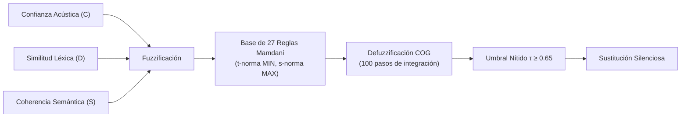
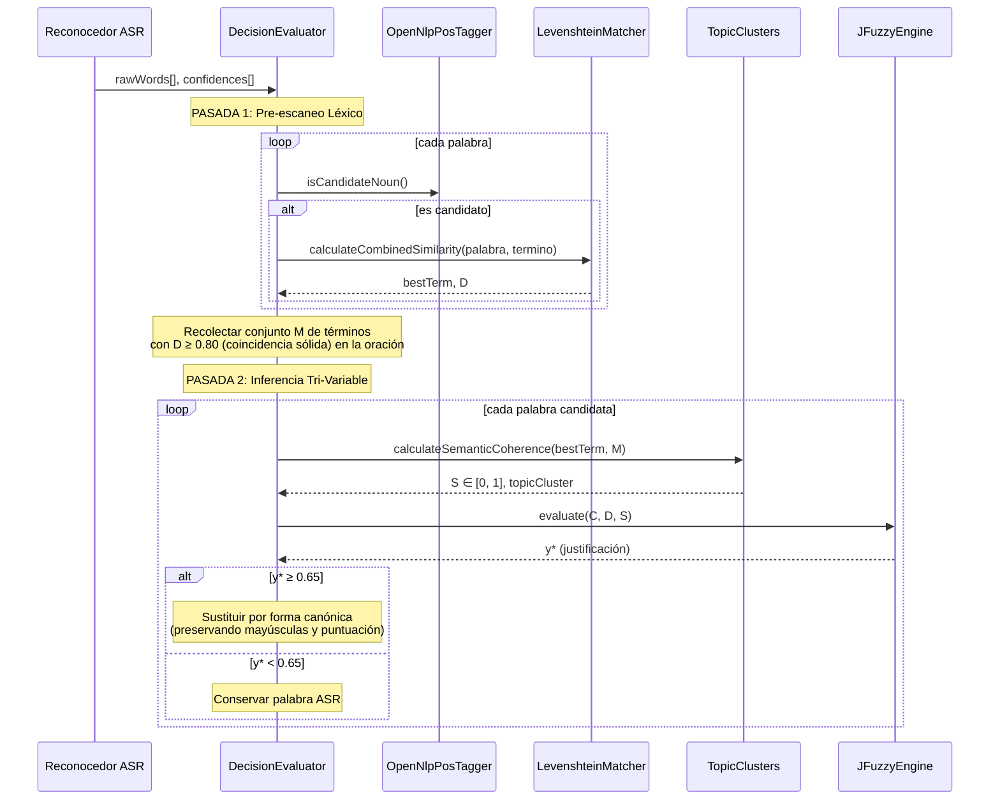

# Factor Semántico en la Corrección Post-ASR mediante Topic Clusters

**Proyecto de Tesis:** Prototipo de Transcripción Asistida y Corrección Difusa para Estudiantes con Discapacidad Auditiva  
**Autor:** Miguel Angel Tinta Aguilar  
**Universidad Nacional de San Agustín de Arequipa (UNSA)**  
**Fecha:** Octubre 2026  

---

## 1. Justificación y Fundamentación Teórica

### 1.1 Limitación del Modelo Bi-Variable (C y D)
El sistema post-ASR original basaba la decisión de sustitución léxica en dos variables de entrada:
1. **$C \in [0.0, 1.0]$ (Confianza Acústica):** Métrica de certidumbre proporcionada por el decodificador ASR del dispositivo Android.
2. **$D \in [0.0, 1.0]$ (Similitud Fonético-Léxica):** Ponderación híbrida entre distancia de edición de Levenshtein normalizada (60%) y similitud fonética hispana normalizada (40%).

Aunque $C$ y $D$ capturan eficientemente la incertidumbre acústica y la proximidad superficial de las palabras, **carecen de conciencia semántica y contextual**. En el contexto de un aula de secundaria:
- Si el docente pronuncia con baja confianza una palabra común o un modismo (por ejemplo: *"cédula de identidad"*), un sistema puramente acústico-léxico puede sustituir erróneamente *"cédula"* por *"célula"* ($D = 0.73$, $C = 0.55 \rightarrow y^* \ge 0.65$), produciendo un falso positivo.
- Por el contrario, cuando el docente explica citología (*"la célula procariota carece de un núcleo definido y su material genético está en el citoplasma"*), la presencia simultánea de términos como *"procariota"*, *"núcleo"* y *"citoplasma"* confirma inequívocamente el contexto biológico.

### 1.2 Incorporación del Factor Semántico $S$
Se introduce una tercera variable lingüística de entrada: **$S \in [0.0, 1.0]$ (Coherencia Semántica Contextual)**, que cuantifica el grado de pertinencia temática de una hipótesis de corrección en relación con las demás palabras académicas emitidas en la misma cláusula u oración pedagógica.

---

## 2. Definición y Modelado Difuso de las Variables

El sistema opera bajo un esquema de **Control Difuso Mamdani** con tres entradas y una salida:

$$\mathcal{F}: (C, D, S) \longrightarrow y^* \in [0.0, 1.0]$$

### 2.1 Funciones de Pertenencia de las Entradas

#### 1. Confianza Acústica ($C$)
- **Baja:** $\text{Trapezoidal}(0.0, 0.0, 0.35, 0.60)$
- **Media:** $\text{Triangular}(0.35, 0.60, 0.80)$
- **Alta:** $\text{Trapezoidal}(0.65, 0.85, 1.0, 1.0)$

#### 2. Similitud Léxico-Fonética ($D$)
- **Baja:** $\text{Trapezoidal}(0.0, 0.0, 0.40, 0.65)$
- **Media:** $\text{Triangular}(0.45, 0.70, 0.85)$
- **Alta:** $\text{Trapezoidal}(0.75, 0.90, 1.0, 1.0)$

#### 3. Coherencia Semántica ($S$) — *Nueva Variable*
- **Baja (Inconexo / Aislado):** $\text{Trapezoidal}(0.0, 0.0, 0.25, 0.45)$
- **Media (Contexto Parcial / Neutro):** $\text{Triangular}(0.30, 0.50, 0.70)$
- **Alta (Fuerte Co-ocurrencia Temática):** $\text{Trapezoidal}(0.55, 0.75, 1.0, 1.0)$

### 2.2 Función de Pertenencia de la Salida: Justificación ($y^*$)
- **Baja:** $\text{Trapezoidal}(0.0, 0.0, 0.30, 0.50)$
- **Media:** $\text{Triangular}(0.35, 0.55, 0.75)$
- **Alta:** $\text{Trapezoidal}(0.60, 0.80, 1.0, 1.0)$

---

## 3. Base de Conocimiento: 27 Reglas Mamdani

Con 3 variables de entrada y 3 conjuntos difusos por entrada, el espacio de inferencia se expande a $3^3 = 27$ reglas formales.

| N° | Confianza ($C$) | Similitud ($D$) | Semántica ($S$) | Consecuente: Justificación ($y^*$) | Fundamentación Pedagógica / Acústica |
|:--:|:---------------:|:---------------:|:---------------:|:----------------------------------:|:--------------------------------------|
| 1  | Baja | Alta | Alta | **Alta** | El reconocedor duda, match léxico alto y contexto confirma el tema. Corrección obligatoria. |
| 2  | Baja | Alta | Media | **Alta** | Audio dudoso y alta coincidencia con contexto aceptable. |
| 3  | Baja | Alta | Baja | **Media** | Parecido fonético pero contexto ajeno; se modera la justificación para evitar falso positivo. |
| 4  | Baja | Media | Alta | **Alta** | Confianza acústica baja; el fuerte contexto semántico rescata un término con similitud media. |
| 5  | Baja | Media | Media | **Media** | Evidencia moderada; no alcanza el umbral de sustitución segura. |
| 6  | Baja | Media | Baja | **Baja** | Término dudoso sin soporte contextual ni acústico; se descarta. |
| 7  | Baja | Baja | Alta | **Media** | El contexto encaja pero la palabra no se parece en nada; riesgo de alucinación. |
| 8  | Baja | Baja | Media | **Baja** | Palabra común o externa al dominio. |
| 9  | Baja | Baja | Baja | **Baja** | Ninguna evidencia respalda la sustitución; se conserva la palabra del reconocedor. |
| 10 | Media | Alta | Alta | **Alta** | Incertidumbre moderada; similitud y contexto fuertes justifican la sustitución. |
| 11 | Media | Alta | Media | **Alta** | Coincidencia clara de término técnico escolar. |
| 12 | Media | Alta | Baja | **Media** | Similitud alta pero discrepancia temática; no supera el umbral $\tau = 0.65$. |
| 13 | Media | Media | Alta | **Alta** | El contexto del cluster temático impulsa la corrección frente a degradación acústica. |
| 14 | Media | Media | Media | **Media** | Coincidencia difusa indeterminada. |
| 15 | Media | Media | Baja | **Baja** | Sin justificación suficiente. |
| 16 | Media | Baja | Alta | **Media** | Palabra pronunciada difiere del candidato sugerido. |
| 17 | Media | Baja | Media | **Baja** | Conservar hipótesis original del ASR. |
| 18 | Media | Baja | Baja | **Baja** | Conservar hipótesis original del ASR. |
| 19 | Alta | Alta | Alta | **Media** | El docente habló con claridad; no sustituir agresivamente si el ASR está seguro ($y^* < 0.65$). |
| 20 | Alta | Alta | Media | **Media** | Conservar la enunciación del docente. |
| 21 | Alta | Alta | Baja | **Baja** | Conservar la enunciación del docente. |
| 22 | Alta | Media | Alta | **Media** | ASR seguro; no forzar sustitución léxica. |
| 23 | Alta | Media | Media | **Baja** | Conservar palabra original. |
| 24 | Alta | Media | Baja | **Baja** | Conservar palabra original. |
| 25 | Alta | Baja | Alta | **Baja** | El docente dijo deliberadamente otra palabra. |
| 26 | Alta | Baja | Media | **Baja** | Conservar palabra original. |
| 27 | Alta | Baja | Baja | **Baja** | Conservar palabra original. |

### Defuzzificación por Centroide de Gravedad (COG)
La superficie difusa agregada $\mu_{agregada}(y)$ se defuzzifica numéricamente mediante integración de Riemann en 100 pasos discretos:

$$y^* = \frac{\int_0^1 y \cdot \mu_{agregada}(y) \, dy}{\int_0^1 \mu_{agregada}(y) \, dy}$$

Si $y^* \ge 0.65$, se ejecuta la **sustitución silenciosa**.

---

## 4. Arquitectura de Dos Pasadas en `DecisionEvaluator`

Para calcular $S$, el sistema debe conocer qué otros términos técnicos co-ocurren en la misma cláusula. Por ello, el pipeline se rediseñó en **dos pasadas desacopladas**:

### Cálculo Formal de $S$
Sea $w_i$ la palabra bajo análisis con término canónico candidato $T_i$.  
Sea $\mathcal{M} = \{T_1, T_2, \dots, T_k\}$ el conjunto de todos los términos del diccionario detectados en la oración con similitud preliminar $D \ge 0.80$ (umbral de contexto; el umbral de candidato a corrección sigue siendo $D \ge 0.50$). Con 0.50 los falsos positivos léxicos ("realiza"→"adrenalina") diluían $S$.  
Sea $\mathcal{C}(T_i) = \{C_1, C_2, \dots, C_m\}$ la familia de Topic Clusters a los que pertenece el término $T_i$.

1. Si $\mathcal{C}(T_i) = \emptyset$ (término sin cluster asignado), $S = 0.20$.
2. Si $\mathcal{M} \setminus \{T_i\} = \emptyset$ (es el único término técnico en la oración, pero pertenece a un cluster curricular válido), se asigna neutralidad: $S = 0.50$.
3. Si existen otros términos en la oración ($\mathcal{M}_{otros} = \mathcal{M} \setminus \{T_i\}$):

$$S = \max_{C \in \mathcal{C}(T_i)} \left( \frac{\sum_{T \in \mathcal{M}_{otros}} \mathbb{I}(T \in C)}{|\mathcal{M}_{otros}|} \right)$$

Donde $\mathbb{I}(\cdot)$ es la función indicadora de pertenencia al cluster $C$. El cluster que maximiza $S$ se asigna como el tema pedagógico dominante de la corrección (`topicCluster`).

---

## 5. Topic Clusters de Biología (Cobertura Curricular MINEDU)

Se estructuró el archivo `app/src/main/assets/clusters/biologia_clusters.json` con **12 clusters temáticos** que abarcan la totalidad de los **403 términos del diccionario de Biología** (100% de cobertura sin términos huérfanos):

1. **`citologia_general` (Citología General y Transporte Celular):** célula, membrana, citoplasma, núcleo, nucleolo, eucariota, procariota, vegetal, animal, citoesqueleto, cilio, flagelo, ósmosis, difusión, cápsula, cápside.
2. **`organelos_celulares` (Organelos Celulares):** mitocondria, cloroplasto, ribosoma, lisosoma, vacuola, retículo, endoplasmático, golgi, centriolo, citoesqueleto, peroxisoma, membrana, citoplasma, tonoplasto.
3. **`genetica_molecular` (Genética y Herencia):** gen, genoma, genotipo, fenotipo, alelo, dominante, recesivo, cromosoma, cromatina, nucleótido, adenina, timina, guanina, citosina, replicación, mutación, herencia, homocigoto, heterocigoto, cariotipo, genética, biotecnología, transgénico, plásmido.
4. **`acidos_nucleicos_sintesis` (Ácidos Nucleicos y Síntesis de Proteínas):** desoxirribonucleico, ribonucleico, nucleótido, adenina, timina, guanina, citosina, uracilo, codón, anticodón, transcripción, traducción, replicación, gen, genoma, proteína, aminoácido.
5. **`division_celular` (División Celular):** mitosis, meiosis, interfase, profase, metafase, anafase, telofase, citocinesis, cromosoma, cromatina, centriolo, haploide, diploide.
6. **`reproduccion_desarrollo` (Reproducción y Desarrollo):** gameto, cigoto, fecundación, óvulo, espermatozoide, haploide, diploide, gametogénesis, embrión, espora, bipartición, gemación, meiosis, polen, polinización, germinación, pistilo, estambre.
7. **`metabolismo_bioenergetica` (Metabolismo, Biomoléculas y Bioenergética):** fotosíntesis, respiración, glucólisis, fermentación, glucosa, enzima, sustrato, catalizador, adenosina, fosfato, anabolismo, catabolismo, metabolismo, cloroplasto, mitocondria, tilacoide, estroma, clorofila, carbohidrato, almidón, celulosa, glucógeno, lípido, colesterol, triglicérido, proteína.
8. **`sistema_nervioso_endocrino` (Coordinación Nerviosa y Endocrina):** neurona, axón, sinapsis, neurotransmisor, dendrita, mielina, adrenalina, hormona, hipotálamo, hipófisis, insulina, glucagón, tiroides, homeostasis.
9. **`sistema_circulatorio_inmune` (Sistemas Circulatorio e Inmunológico):** corazón, aurícula, ventrículo, arteria, vena, capilar, hemoglobina, eritrocito, leucocito, plaqueta, plasma, linfa, anticuerpo, antígeno, inmunidad, linfocito, fagocito, vacuna.
10. **`sistemas_digestion_respiracion_excrecion` (Nutrición Animal: Digestión, Respiración y Excreción):** pulmón, alvéolo, bronquio, tráquea, diafragma, hematosis, respiración, riñón, nefrona, glomérulo, estómago, esófago, intestino, duodeno, hígado, páncreas, bilis, quimo, peristaltismo.
11. **`botanica_tejidos` (Botánica y Tejidos Biológicos):** xilema, floema, savia, estoma, meristemo, tejido, epitelial, conectivo, angiosperma, gimnosperma, cantuta, queñual, totora, quina.
12. **`ecologia_evolucion_taxonomia` (Ecología, Evolución y Biodiversidad):** ecosistema, bioma, biotopo, biocenosis, hábitat, nicho, biodiversidad, población, comunidad, autótrofo, heterótrofo, trófica, biomasa, simbiosis, depredación, mutualismo, parasitismo, comensalismo, evolución, adaptación, selección, fósil, especiación, homología, analogía, filogenia, ancestro, darwinismo, mutación, especie, taxonomía, género, filo, monera, protista, fungi, plantae, animalia, animal, vegetal, bacteria, bacilo, coco, arquea, virus, retrovirus, alga, hongo, levadura, protozoario, parásito, patógeno, flora, fauna, endémico, anchoveta, cóndor, vicuña.

---

## 6. Telemetría, Historial y Auditoría

Para brindar trazabilidad científica durante las pruebas con estudiantes y docentes:
1. **`SessionLogEntity` (Room DB v2):** Se añadieron las columnas `semanticCoherence: Float` y `topicCluster: String?`.
2. **`SessionStats`:** Se añadió `averageSemanticScore: Double`.
3. **`CorrectionsHistoryScreen` (Interfaz de Usuario):**
   - Muestra el cluster pedagógico detectado en verde de alto contraste: `Tema: Citología General y Transporte Celular`.
   - Presenta las tres métricas difusas en cada tarjeta de corrección: `C: XX% | D: XX% | S: XX% | Justif. y*: 0.XX`.

---

## 7. Verificación y Resultados de Pruebas Unitarias

Se ejecutó la suite de pruebas unitarias (`./gradlew test`) con Java 21 JBR, obteniendo **100% de éxito (BUILD SUCCESSFUL)**:

1. **`FuzzyEngineTest`:**
   - `testLowConfidenceHighSimilarity_approvesSubstitution`: Aprobado ($y^* \ge 0.65$).
   - `testHighConfidenceLowSimilarity_rejectsSubstitution`: Aprobado ($y^* < 0.65$).
   - `testLowConfidenceLowSimilarity_rejectsSubstitution`: Aprobado ($y^* < 0.65$).
   - `testSemanticContext_boostsJustification`: Comprueba que $S_{alta}$ genera una justificación mayor que $S_{baja}$ frente a idénticas condiciones acústicas y léxicas.
   - `testHighConfidence_preservesTeacherSpeechRegardlessOfSemantics`: Comprueba que si $C = 0.95$, no se sustituye arbitrariamente.
2. **`DecisionEvaluatorTest`:**
   - `testTwoPassCoOccurrence_correctsSedulaToCelulaWithCluster`: Valida que la frase escolar *"sedula procariota carece de nukleo"* sustituye *"sedula"* $\rightarrow$ *"célula"* con $S > 0.50$ y cluster activado *"Citología General"*.
   - `testUnrelatedWord_doesNotStealClusterContext`: Valida que palabras no técnicas no activen erróneamente sustituciones.
3. **`LevenshteinMatcherTest` & `WerCalculatorTest`:** Aprobados sin regresiones.

---

## Extensión: Memoria de la Clase (S contextual de lección)

**Motivación.** El docente habla en frases cortas; una oración con un único término técnico no tiene co-ocurrencias y recibía $S = 0.50$ neutro, desperdiciando lo que se dijo segundos antes.

**Modelo.** Se mantiene un peso $w_k$ por cluster $k$ (12 en Biología). Al cerrar una oración **final** del ASR, cada término sólido ($D \ge 0.80$) suma $1/|\mathcal{C}(T)|$ a los clusters que lo contienen. Los pesos decaen con el tiempo:

$$w_k(t) = w_k(t_0)\cdot 2^{-(t-t_0)/\tau},\qquad \tau = 45\ \text{s}$$

Para un candidato $T_i$ con clusters $\mathcal{C}(T_i)$:

- Afinidad: $L = \max\!\left(0.20,\ \dfrac{\max_{k\in\mathcal{C}(T_i)} w_k}{\max_k w_k}\right)$
- Crédito por área: si el candidato está en otro cluster de la misma área temática que el tema dominante, $L$ se eleva hasta $0.5\cdot W_{\text{área}}/W_{\text{área dominante}}$.
- Fuerza: $\rho = \min\!\left(1,\ \dfrac{\max_k w_k}{3}\right)$ (3 términos sólidos recientes = confianza plena). Si $\max_k w_k < 0.5$ no hay memoria útil.

Con $S_{\text{oración}}$ definido arriba (o ausente si no hay otros términos):

| Situación | $S$ |
|---|---|
| Sin $S_{\text{oración}}$ y sin memoria | $0.50$ |
| Solo memoria | $0.50 + (L - 0.50)\,\rho$ |
| Solo oración | $S_{\text{oración}}$ (fórmula original) |
| Ambas | $(1 - 0.4\rho)\,S_{\text{oración}} + 0.4\rho\,L$ |

El modelo sigue siendo **trivariado**: $S$ entra al motor Mamdani de 27 reglas junto con $C$ y $D$.

**Tiempo real.** Costo $O(|\mathcal{C}(T_i)|)$ por palabra (~1 µs medido en JVM), seguro entre hilos; los resultados parciales solo consultan la memoria, no la modifican. Se reinicia al cambiar de asignatura o limpiar la sesión. Implementación: `LessonContext.kt`, `DecisionEvaluator.kt`; espejo en `benchmark_runner.py`.

### Mejoras posteriores a la memoria de clase

Se incorporaron cuatro cambios, cada uno motivado por un fallo concreto observado y con su prueba automática. Todos mantienen el modelo **trivariado**: $S$ sigue entrando al motor de 27 reglas.

**1. Selección del candidato con los tres factores (rerank).** Antes, el término del diccionario se elegía solo por mayor $D$ y $S$ solo aprobaba o rechazaba. Ahora se evalúan hasta 3 candidatos y gana el de mayor $y^*$ (empate: mayor $D$). Un candidato alternativo compite solo si está a menos de 0.12 de $D$ del mejor **y** su $D \ge 0.70$. Ejemplo: en "la sedula tiene nucleo y citoplasma", *sedula* está más cerca de *médula* ($D = 0.83$, $S = 0$, $y^* = 0.47$) que de *célula* ($D = 0.73$, $S = 0.67$, $y^* = 0.77$); con rerank gana *célula*.

**2. Salvaguardas fuera del motor difuso.** Con $C = 0.65$ constante aparecieron falsos positivos que los corpus con confianzas sintéticas ocultaban: dentro de una clase de mitosis, "produce"→*profase* ($D = 0.63$), "meyosis"→*mitosis*, "gametos"→*gameto* (plural→singular). Para sustituir deben cumplirse **las tres condiciones**: $y^* \ge 0.65$, $D \ge 0.70$ (la corrección legítima más débil observada es *sedula*→*célula*, 0.73) y que la palabra no sea el plural/singular regular del término.

**3. Áreas temáticas (macro) con crédito parcial.** Los clusters son finos: *célula* está solo en `citologia_general` y *mitocondria* en `organelos_celulares` y `metabolismo_bioenergetica`, de modo que "la cedula y la mitocondria" (el ejemplo que muestra la propia app) obtenía $S = 0$ y no se corregía. Cada cluster de Biología declara un `macro_id` (4 áreas: biología celular, genética y herencia, fisiología humana, botánica y ecología). Un término de otro cluster **de la misma área** aporta crédito 0.5 (en la oración) y la memoria de clase aplica el mismo crédito. *La agrupación en áreas es una propuesta del desarrollador y debe ser validada por un docente de Biología.*

**4. La memoria solo aprende de términos resueltos.** Antes anotaba cualquier coincidencia fuerte, incluidos candidatos rechazados; un error ("sedula"→*médula*) se reforzaba a sí mismo. Ahora solo registra términos sustituidos o ya bien escritos.

### Resultados de ablación

`python3 evaluation/benchmark_runner.py --ablacion` (WER difuso; todas las variantes son trivariadas). ASR crudo: 18.45 % (`corpus_arequipa`) y 17.24 % (`corpus_clase_continua`). En ambos escenarios, el corpus de control de 12 frases cotidianas da **0 falsos positivos**.

| Variante | `arequipa` (conf. sintética) | `continua` (conf. sintética) | `arequipa` ($C = 0.65$) | `continua` ($C = 0.65$) |
|---|---|---|---|---|
| $S$ solo oración (con áreas) | 3.88 % | 1.72 % | 4.85 % | 1.72 % |
| + memoria de clase | 2.91 % | 1.72 % | 3.88 % | 1.72 % |
| + rerank (sin memoria) | – | – | 3.88 % | 1.72 % |
| **+ memoria + rerank** | **1.94 %** | **1.72 %** | **2.91 %** | **1.72 %** |

Con el modelo completo en `corpus_arequipa`: 21 sustituciones, **WER 18.45 % → 1.94 %**, KER 61.29 % → 6.45 % (precisión semántica 93.55 %).

**Comparación contra una regla booleana** (`--booleana`: mejor par de umbrales "$D \ge x$ y $C \le y$" hallado por búsqueda en malla **sobre los mismos corpus**):

| Sistema | `arequipa` (sint.) | `continua` (sint.) | `arequipa` ($C = 0.65$) | `continua` ($C = 0.65$) |
|---|---|---|---|---|
| Booleana óptima | 2.91 % | 0.00 % | 4.85 % | 3.45 % |
| Difusa completa | 1.94 % | 1.72 % | 2.91 % | 1.72 % |

**Estabilidad de los parámetros** (modelo completo): el umbral $y^*$ da resultados idénticos entre 0.60 y 0.75; con $\le 0.55$ aparece 1 falso positivo en el control. La vida media $\tau$ da resultados idénticos entre 20 y 90 s y solo empeora con 120 s (la clase continua pasa de 1.72 % a 3.45 %: tras un cambio de tema se retrasa la adaptación).

### Lectura honesta de los resultados

- **Estos números son "dentro de la muestra".** Las mejoras 3 y 4 se decidieron tras observar fallos en estos mismos corpus, y la regla booleana también se ajustó sobre ellos. No son evidencia de generalización.
- **Con confianza neutra** (lo que Android entrega en la práctica) el sistema difuso completo supera a la mejor regla booleana en ambos corpus. **Con confianzas sintéticas informativas** hay empate técnico: gana el difuso en uno y la booleana en el otro. Esas confianzas "filtran" la respuesta (están bajas justo en las palabras erradas), por eso favorecen a la booleana.
- **Cada componente suma** en el escenario realista (4.85 % → 3.88 % → 2.91 %), pero con 8 y 13 frases una palabra mueve varios puntos: no es significancia estadística.
- Los corpus son **sintéticos**: errores de ASR inventados y confianzas asignadas a mano. Se requiere un corpus de voz real con transcripción de referencia.
- Limitación conocida: el conjunto de contexto $\mathcal{M}$ de la oración se arma con el mejor candidato por $D$ de cada palabra; un candidato equivocado puede contaminar el contexto de las demás.
