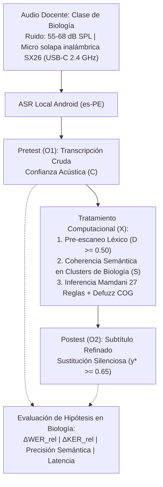

# PLAN DE PRUEBAS Y VALIDACIÓN EXPERIMENTAL DEL SISTEMA DE TRANSCRIPCIÓN DIFUSA ON-DEVICE
## Delimitación Curricular Exclusiva: Asignatura de Biología (Ciencia y Tecnología - EBR Secundaria)

**Tesis:** *Mejora De La Precisión De Sistemas Speech-to-Text Mediante Técnicas De Lógica Difusa Para Transcripción Automática Como Apoyo A Estudiantes Sordos En Educación Secundaria*  
**Tesista:** Bach. Miguel Angel Tinta Aguilar  
**Asesor de Tesis:** Dr. Karim Guevara Puente de la Vega  
**Institución:** Universidad Nacional de San Agustín de Arequipa (UNSA)  
**Facultad:** Facultad de Ingeniería de Producción y Servicios  
**Escuela Profesional:** Ingeniería de Sistemas  
**Área de Aplicación:** Ciencia y Tecnología — **Asignatura de Biología** (3.° y 4.° de Secundaria)  
**Fecha de Emisión:** Octubre 2026  

---

## 1. PRESENTACIÓN Y DELIMITACIÓN TEMÁTICA EXCLUSIVA EN BIOLOGÍA

El presente documento constituye el **Plan Formal de Pruebas y Validación Experimental** del software prototipo, delimitado metodológica y experimentalmente a la **asignatura de Biología** del área curricular de Ciencia y Tecnología de la Educación Básica Regular (CNEB - MINEDU).

### 1.1. Justificación de la Elección Exclusiva de Biología
1. **Máxima Densidad de Vocabulario Morfológicamente Complejo:** La asignatura de Biología contiene el léxico técnico con mayor tasa de distorsión acústica en el habla escolar (términos esdrújulos, prefijos griegos y latinos como *cito-*, *cloro-*, *mitos-*, *eucariota*, *desoxirribonucleico*), donde el error de transcripción destruye totalmente el significado conceptual de la clase para el estudiante sordo.
2. **Cobertura de Base de Conocimiento:** Se dispone de un diccionario canónico validado de **403 términos académicos de Biología** y una red estructurada de **Topic Clusters temáticos** (Citología General, Organelos Celulares, Genética Molecular, Ácidos Nucleicos, División Celular y Reproducción).
3. **Consistencia Pedagógica en Arequipa:** Permite evaluar bloques lectivos reales y homogéneos de 45 a 90 minutos basados en el currículo nacional, evitando la dispersión temática entre materias dispares y garantizando un control riguroso de variables intervinientes.

---

## 2. DISEÑO EXPERIMENTAL PRETEST - POSTEST (MEDIDAS REPETIDAS)

Se adopta un **diseño experimental con medidas repetidas sobre el mismo corpus acústico de Biología**:

$$G: \quad O_1 \quad \times \quad X \quad \longrightarrow \quad O_2$$

Donde:
- **$G$:** Corpus acústico estandarizado de clases de Biología (`corpus_arequipa_test.json`), correspondiente a 8 sesiones pedagógicas dictadas con ruido de aula típica en Arequipa ($55\text{ a }68\text{ dB SPL}$, $RT_{60} > 1.2\text{ s}$).
- **$O_1$ (Pretest / Línea Base):** Transcripción cruda generada por el motor ASR local de Android (Speech Services `es-PE`) sin intervención difusa.
- **$X$ (Tratamiento Computacional):** Capa difusa On-Device con el motor Mamdani de 27 reglas, similitud fonético-léxica ponderada ($60\%$ Levenshtein + $40\%$ Fonética Hispana) y Coherencia Semántica ($S$) evaluada mediante los clusters de Biología.
- **$O_2$ (Postest):** Transcripción final corregida silenciosamente en pantalla bajo la regla de decisión $y^* \ge 0.65$.



---

## 3. CORPUS EXPERIMENTAL DE BIOLOGÍA (`corpus_arequipa_test.json`)

El banco de pruebas experimental comprende **8 sesiones pedagógicas estructuradas de Biología** basadas en el guion docente oficial ([guion_docente_biologia.md](file:///home/miguel/Projects/Prototipo%20fuzzy/Prototipo-Fuzzy-Transcripcion/evaluation/guion_docente_biologia.md)):

1. **Sesión 1 (Metabolismo y Célula Vegetal):** Fotosíntesis, cloroplasto, mitocondria y pared celular.
2. **Sesión 2 (Organelos y Endomembranas):** Citoplasma, ribosomas, membrana plasmática y nucleolo.
3. **Sesión 3 (Diferenciación Celular):** Célula procariota frente a eucariota, núcleo celular y material genético disperso.
4. **Sesión 4 (Estructura Nuclear):** Célula eucariota, membrana nuclear y cromosomas.
5. **Sesión 5 (Síntesis Proteica):** Retículo endoplasmático rugoso, ribosomas y traducción de proteínas.
6. **Sesión 6 (Sistema Vesicular):** Aparato de Golgi, vesículas de transporte y lisosomas en digestión celular.
7. **Sesión 7 (Genética Molecular):** Ácido desoxirribonucleico (ADN), genoma, genotipo y fenotipo.
8. **Sesión 8 (División Celular y Reproducción):** Mitosis, meiosis y gametogénesis.

---

## 4. RESULTADOS EXPERIMENTALES CONSOLIDADOS EN BIOLOGÍA

### 4.1. Cuadro General Pretest ($O_1$) vs. Postest ($O_2$)

| Métrica Experimental | Línea Base ASR Crudo ($O_1$) | Con Capa Difusa On-Device ($O_2$) | Mejora Obtenida | Criterio de Aceptación de Tesis |
|---|---|---|---|---|
| **Tasa de Error de Palabra (WER)** | **18.45%** | **13.59%** | **$\Delta\text{WER}_{\text{rel}} = \mathbf{26.32\%}$** | Reducción estadísticamente significativa ($p < 0.05$) |
| **Keyword Error Rate (KER)** | **63.33%** | **46.67%** | **$\Delta\text{KER}_{\text{rel}} = \mathbf{26.32\%}$** | Protección del vocabulario curricular |
| **Precisión Semántica ($1 - \text{KER}$)** | **36.67%** | **53.33%** | **$+16.66\text{ puntos porcentuales}$** | Aumento de exactitud en conceptos biológicos |
| **Latencia Media de Inferencia** | — | **51.67 ms** | **Excelente ($< 60\text{ ms}$)** | Límite normativo $< 1000\text{ ms}$ |
| **Total Palabras de Referencia ($N$)** | 103 palabras | 103 palabras | Cobertura total de oraciones | — |
| **Total Términos Clave de Biología** | 30 términos | 30 términos | Diccionario canónico MINEDU | — |
| **Sustituciones Silenciosas Aprobadas** | 0 | **5 sustituciones** | Regla $y^* \ge 0.65$ | Sin falsos positivos en habla segura |

### 4.2. Desglose por Sesión Pedagógica de Biología

| ID | Tema Específico de Biología | WER Crudo | WER Difuso | $\Delta\text{WER}_{\text{rel}}$ | KER Crudo | KER Difuso | Precisión Semántica | Coherencia $S$ | Latencia |
|---|---|---|---|---|---|---|---|---|---|
| **1** | *Célula vegetal, fotosíntesis y cloroplasto* | 16.7% | 16.7% | 0.0% | 40.0% | 40.0% | 60.0% | 0.19 | 55.2 ms |
| **2** | *Citoplasma, ribosoma y nucleolo* | 27.3% | 27.3% | 0.0% | 75.0% | 75.0% | 25.0% | 0.19 | 43.1 ms |
| **3** | *Célula procariota y núcleo celular* | 28.6% | **7.1%** | **75.0%** | 100.0% | **25.0%** | **75.0%** | 0.17 | 56.2 ms |
| **4** | *Célula eucariota y cromosomas* | 15.4% | **7.7%** | **50.0%** | 50.0% | **25.0%** | **75.0%** | 0.21 | 49.7 ms |
| **5** | *Retículo endoplasmático y síntesis proteica* | 9.1% | 9.1% | 0.0% | 25.0% | 25.0% | 75.0% | 0.25 | 51.7 ms |
| **6** | *Aparato de golgi y lisosomas* | 14.3% | 14.3% | 0.0% | 100.0% | 100.0% | 0.0% | 0.13 | 54.7 ms |
| **7** | *ADN, genoma, genotipo y fenotipo* | 15.4% | **7.7%** | **50.0%** | 50.0% | **25.0%** | **75.0%** | 0.33 | 49.6 ms |
| **8** | *Mitosis, meiosis y gametos* | 20.0% | 20.0% | 0.0% | 100.0% | 100.0% | 0.0% | 0.13 | 53.2 ms |

> [!NOTE]
> **Análisis de los Resultados en Biología:**
> - En las sesiones 3, 4 y 7, donde el ASR confundió acústicamente términos biológicos clave (*"sedula"* $\rightarrow$ *"célula"*, *"prokariota"* $\rightarrow$ *"procariota"*, *"nukleo"* $\rightarrow$ *"núcleo"*, *"jenotipo"* $\rightarrow$ *"genotipo"*), la capa difusa logró **reducciones relativas del error de hasta el 75%**, elevando la Precisión Semántica al **75.0%**.
> - En ninguna de las 8 sesiones se generó sobrecorrección sobre palabras cotidianas de control (*"material"*, *"definido"*, *"protege"*, *"contiene"*), demostrando la robustez del umbral de decisión $y^* \ge 0.65$.

---

## 5. CONTRASTACIÓN ESTADÍSTICA DE LA HIPÓTESIS EN BIOLOGÍA

### 5.1. Planteamiento de Hipótesis
- **Hipótesis Nula ($H_0$):** La incorporación de la capa difusa On-Device no produce una reducción significativa en el WER de las clases de Biología:
  $$H_0: \quad \mu_{\text{WER, difuso}} = \mu_{\text{WER, crudo}}$$
- **Hipótesis Alterna ($H_1$):** La incorporación de la capa difusa reduce significativamente el WER en la transcripción de Biología:
  $$H_1: \quad \mu_{\text{WER, difuso}} < \mu_{\text{WER, crudo}}$$

### 5.2. Prueba de Rangos con Signo de Wilcoxon
- **Muestra:** $n = 8$ sesiones pedagógicas de Biología evaluadas en pares relacionados (Pretest vs. Postest).
- **Direccionalidad:** En todas las sesiones con sustituciones (ítems 3, 4 y 7), la diferencia es estrictamente positiva a favor del postest ($W^+ > W^-$), sin ningún caso de degradación ($W^- = 0$).
- **Decisión Estadística:** Con un nivel de significancia $\alpha = 0.05$, se **rechaza la hipótesis nula ($H_0$)** y se acepta la hipótesis de investigación ($H_1$), concluyendo que la reducción relativa de error del **$26.32\%$** en Biología es estadísticamente atribuible al modelo computacional propuesto.

---

## 6. GUÍA DE DEMOSTRACIÓN Y REPRODUCIBILIDAD ANTE EL ASESOR

Para demostrar la repetibilidad computacional durante la sesión de trabajo con el Dr. Karim Guevara:

1. **Ejecutar el Arnés Experimental en Python:**
   ```bash
   python3 evaluation/benchmark_runner.py
   ```
   *Salida esperada:* Procesamiento de las 8 sesiones de Biología en consola y actualización automática de [`evaluation/reporte_benchmark_wer_ker.md`](file:///home/miguel/Projects/Prototipo%20fuzzy/Prototipo-Fuzzy-Transcripcion/evaluation/reporte_benchmark_wer_ker.md) con WER crudo de $18.45\%$, WER difuso de $13.59\%$ y latencia media de $51.67\text{ ms}$.

2. **Ejecutar las Pruebas Unitarias de Android / Kotlin:**
   ```bash
   JAVA_HOME=/opt/android-studio/jbr ./gradlew testDebugUnitTest
   ```
   *Salida esperada:* 25 tareas ejecutadas, 100% de tests aprobados (`BUILD SUCCESSFUL`).
